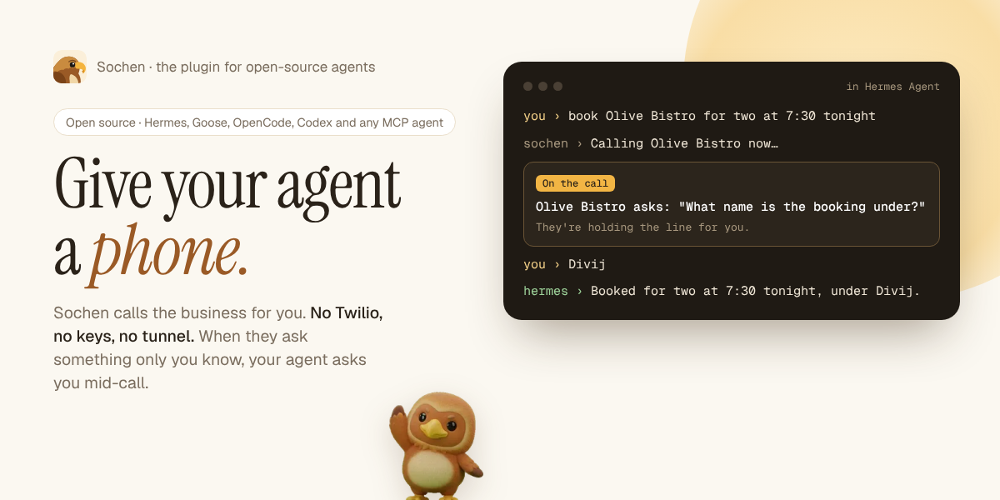

# Sochen plugin



**Hand Sochen the jobs your agent can't do on its own, and hear back when they're done.**

[Sochen](https://sochen.dev) gives any open-source agent a phone, a computer in the cloud, and the
email and calendar you connect to it. Your agent hands it a job:

- phone a US business and bring back what they said, with nothing to set up (no Twilio account, number
  or voice keys)
- research or browsing that keeps running after you close the laptop
- an email or calendar job that waits for your OK

This repo is the Sochen plugin. Its first native home is **Hermes Agent** (everything below). Goose,
OpenCode, Codex CLI, Cline and other MCP agents get the same jobs, mid-call questions included, from
Sochen's MCP server: the setup for each is at [sochen.dev/agents](https://sochen.dev/agents).

**When the business asks something only you can answer, you answer it in your agent.** Mid-call, "what name
should I put the booking under?" comes to your Hermes chat while the business holds the line; your reply
goes straight back into the call, and Sochen says it. No answer within about a minute, and Sochen tells
them you'll follow up.

Hermes keeps talking to you while Sochen works, and tells you when the job is done.

Three Indian paperwork tools work straight after install, with no account: GST invoices, rent receipts
for HRA, and UPI bill splits.

```bash
hermes plugins install N-45div/sochen-plugin --enable
```

## What you get

| | What it does | Account |
|---|---|---|
| `sochen_handoff` | Hands Sochen a job: a phone call, a long research job, an email or calendar task. Returns the answer, or "working" with a link. | Sochen key |
| `sochen_job` | Checks a job without sending it anything: working, needs your OK, answered or failed. While a call goes on, it waits up to a minute for news, so Hermes stays with the call. | Sochen key |
| `sochen_answer` | Passes your answer to a question the business asked mid-call; Sochen says it on the line. | Sochen key |
| `sochen_desk` | Your Sochen desk: what waits for your OK, what's running, what finished today. | Sochen key |
| `sochen_gst_invoice` | An Indian GST tax invoice as a PDF: CGST and SGST within a state, IGST across states, and a UPI QR for the total. | None, free |
| `sochen_rent_receipts` | Monthly house rent receipts for an HRA claim, three to an A4 page. | None, free |
| `sochen_upi_split` | A shared bill split per person, with a UPI QR for each share. | None, free |

The plugin also adds:

- **Hermes asks before a job uses your credits.** `sochen_handoff` goes through Hermes's own approval
  prompt (once, for the session, or always). In unattended runs like cron, nobody can answer the
  prompt, so Hermes's approval rules decide.
- **Finished jobs come back to you.** On your next message, Hermes hears which jobs it handed off have
  finished, stopped or now need your OK, and tells you once. You don't need to keep asking.
- **Hermes stays on a call with you.** While a call goes on, Hermes follows it, and any question from
  the business reaches you in the same chat, in the terminal, Telegram or Hermes Desktop alike.
- **`/sochen`** works in the terminal, Telegram, Discord, Slack and Hermes Desktop:
  - `/sochen` on its own shows your desk.
  - `/sochen jobs` shows the jobs Hermes handed off and how each one stands.
  - `/sochen credits` shows what's left to spend.
  - `/sochen <a job>` hands a job straight to Sochen, through the same approval prompt.
- **A Sochen page in Hermes Desktop**, in the sidebar:
  - your desk, with a link to each job
  - a status-bar count when something needs you
  - a line from your Hermes pet when a job finishes or needs you
- **A "Sochen morning desk" blueprint**: `/blueprint sochen:morning-desk` sends you a short summary
  each morning of what waits for your OK.
- **A skill** (`sochen:sochen`) that tells Hermes when a job is worth handing off and how to write it.

## Connect your Sochen account

The free tools need nothing. For everything else:

1. Make a key at **[sochen.dev/agents](https://sochen.dev/agents)**. Every account gets **100 free API credits**,
   spread over as many jobs as you like.
2. Give the key to Hermes:

   ```bash
   hermes config set SOCHEN_API_KEY sk_sochen_your_key
   ```

   Or in Hermes Desktop: Settings → Plugins → Sochen → API key.

3. Ask Hermes for something it can't do alone, for example:

   > Have Sochen call Joe's Pizza at +1 415 555 0134 and ask if they're open until 11 tonight and
   > whether they deliver to 94110. Don't order anything.

   Or type `/sochen` to see your desk.

Phone calls go to US businesses, with nothing to set up: no number to add or verify. The free
credits cover one call of up to 3 minutes, so you can hear it work; more calls need paid API
credits (a pack or a monthly plan). Sochen says on each call that it's an AI
calling for you. Asking for a business in another country (India included) puts you on that
country's waitlist, and you're emailed when calls there open.

## Credits

Jobs run as ordinary Sochen chats and use your Sochen **API credits**, which are apart from the
Sochen app's plans (neither pays for the other):

- Every account gets **100 free API credits**, spread over as many jobs as you like (one free start
  per inbox).
- After that, packs of API credits that never expire, or a monthly Builder or Scale plan with more
  jobs at once: [API pricing](https://sochen.dev/pricing#api). Billing on sochen.dev lists
  every turn.
- Checking a job, your desk or your credits costs nothing. The invoice, rent receipt and bill split
  tools are free, with no account.
- Replies carry `credits_left`, `/sochen` and the Desktop page show what's left, and when it runs out
  Sochen's reply links to where to get more.

## You stay in charge

- **Hermes asks first.** Before `sochen_handoff` runs, Hermes shows the job and asks you. You can turn
  this off in the plugin's settings.
- **Sochen asks on your phone.** Anything that pays, orders, books, sends or deletes waits for your OK in
  the Sochen app, with the details shown first. Hermes can't approve it, and the plugin has no way to.
- **Your key stays in Hermes.** The plugin reads it through Hermes's secret store for the active profile.
  It never reads files, and never sends the key anywhere but Sochen's API.

## Settings

Under `plugins.entries.sochen.settings` in `config.yaml`, or in Hermes Desktop under Settings → Plugins → Sochen:

| Setting | Default | |
|---|---|---|
| `api_key` (secret, `SOCHEN_API_KEY`) | none | Your Sochen key. The free tools work without it. |
| `ask_before_handoff` | `true` | Hermes asks before handing Sochen a job. |
| `report_finished_jobs` | `true` | Hermes hears about finished jobs on your next message. |
| `base_url` | `https://sochen.dev` | Change only if you run Sochen yourself. |

## What it does on your computer and the network

- **Network:** HTTPS to `sochen.dev` only:
  - the Agent API (`/api/v1/run`, `/api/v1/jobs/…`, `/api/v1/desk`) with your key
  - the public tools endpoint (`/api/mcp`) for the free tools, with no key

  It sends the job Hermes writes for Sochen, or the invoice, receipt or bill details you ask for. It
  doesn't send your Hermes chats, files or memory.
- **Checks on jobs:**
  - When you send a message and a job Hermes handed off is still open, the plugin checks up to two
    jobs. It waits at most 4 seconds per check, and checks each job no more than every 20 seconds.
  - While Hermes Desktop is open with the plugin enabled, the Sochen page reads your desk every 30
    seconds.
  - There are no other background processes and no shell commands.
- **Stored on your computer:** a short list of the jobs Hermes handed off (id, a short label, status),
  in the plugin's own state for the active profile. It keeps 40 at most, each for 7 days. No secrets
  are stored there.
- **Telemetry:** none. Requests name the plugin (`hermes-sochen/<version>`) so Sochen can count runs by
  the tool that sent them. Nothing about what a job says is counted.
- **Your Sochen account:** jobs run as ordinary Sochen chats on your API credits, and appear in your
  chat list at sochen.dev. Files from the free tools are kept for 24 hours behind their link. Sochen's
  [privacy policy](https://sochen.dev/privacy) applies.

## Develop

```bash
python3 -m unittest discover -s tests
node --import ./tests/desktop/register.mjs --test tests/desktop/plugin.test.mjs
hermes plugins validate . --install-deps
```

The tests drive the plugin through a stand-in Hermes context and a stand-in Sochen server, and the
Desktop page through stand-ins for its SDK. To try it against a Sochen running on your own computer,
set `base_url` to `http://localhost:3210`. Only `https` addresses, or `http` on this computer, are
accepted.

Sochen's Agent API is documented at [sochen.dev/developers/agent](https://sochen.dev/developers/agent).

## License

MIT. The plugin is open source. Sochen, the service it talks to, is run by the Sochen team.
